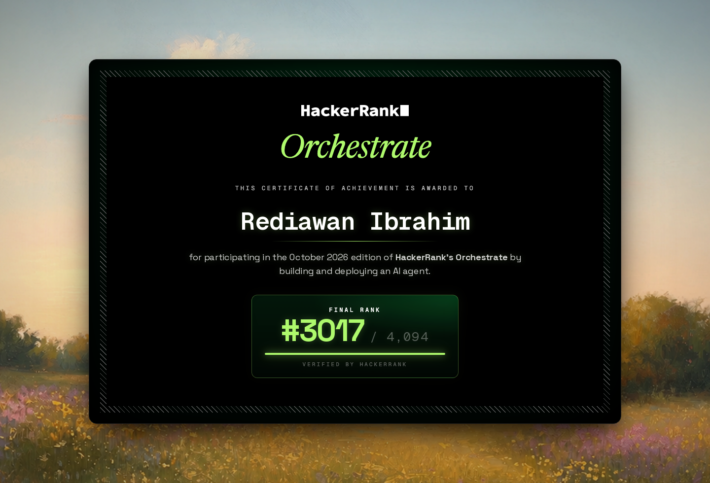
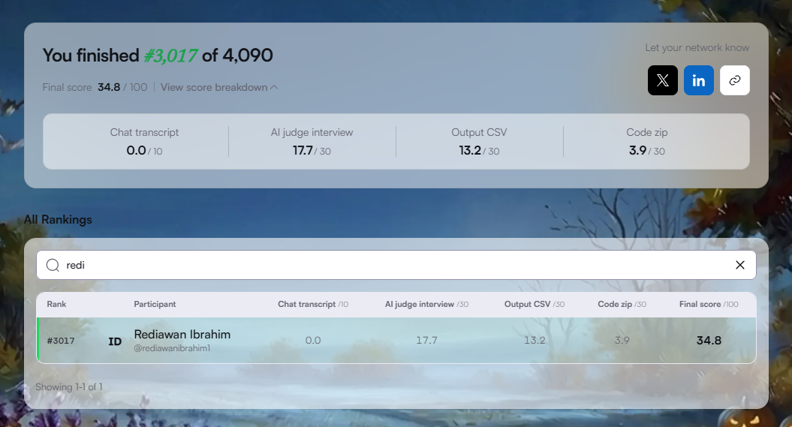

# HackerRank Orchestrate — October 2026

My participation in **HackerRank Orchestrate October 2026**, my first experience in HackerRank's AI agent engineering competition.

## Competition Overview

**Challenge:** Ghost Data Still Exists

The challenge focused on building an AI agent for data deletion auditing. The agent needed to investigate whether requested data had actually been deleted across multiple systems, identify residual data and incomplete deletion processes, evaluate evidence, and determine appropriate remediation steps.

This required reasoning about distributed system states, evidence relationships, deletion workflows, and data integrity.

## Final Competition Results

| Metric | Result |
| --- | ---: |
| Total Registrations | 52,825 |
| Total Participants | 4,094 |
| Final Rank | **#3,017 / 4,094** |
| Final Score | **34.8 / 100** |

### Score Breakdown

| Evaluation Component | Score |
| --- | ---: |
| Chat Transcript | 0.0 / 10 |
| AI Judge Interview | 17.7 / 30 |
| Output CSV | 13.2 / 30 |
| Code ZIP | 3.9 / 30 |
| **Total** | **34.8 / 100** |

## Competition Highlights

- Built a deterministic, evidence-oriented deletion audit solution.
- Processed 518 deletion requests and thousands of evidence observations.
- Generated structured audit results with deletion statuses and remediation steps.
- Completed the AI Judge Interview.
- Evaluated the solution against labeled test cases and identified areas for improvement.

## Key Learnings

This first participation provided valuable experience in:

- Designing AI agents for complex engineering workflows.
- Evidence validation and traceability.
- Deterministic reasoning and structured output generation.
- Evaluating agent behavior and identifying implementation weaknesses.
- Understanding the importance of robust testing and remediation completeness.

The results highlighted opportunities to improve evidence correlation, dependency tracking, deletion workflow analysis, and exact remediation sequence generation.

## Certificate

## Final Results

## Acknowledgment

This competition was my first HackerRank Orchestrate experience. Although there is significant room for improvement, it provided a practical opportunity to build, test, evaluate, and reflect on an AI agent engineering solution.

**One competition completed. More to learn, build, and improve.**
