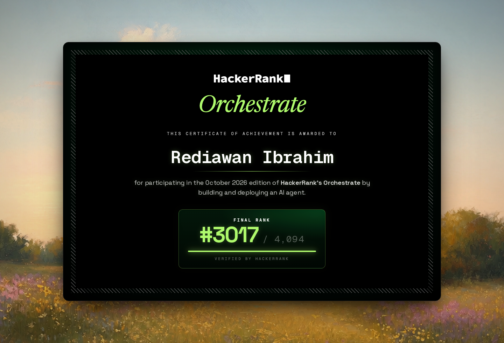
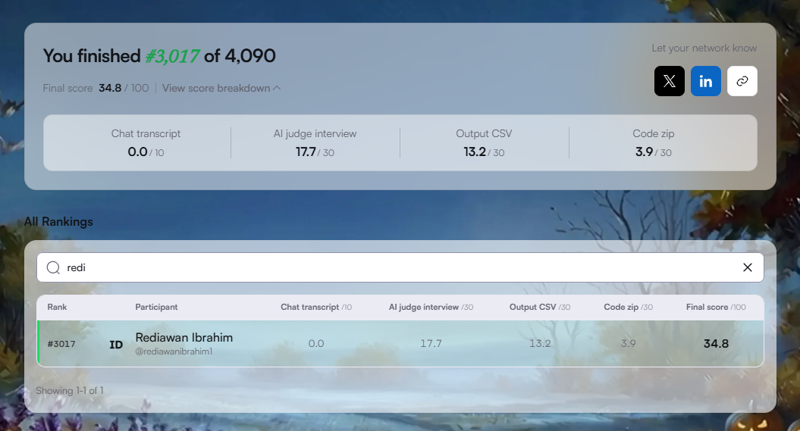

# Competition Results — HackerRank Orchestrate October 2026

## 1. Competition Information

| Attribute | Details |
| --- | --- |
| Competition | HackerRank Orchestrate — October 2026 |
| Challenge | Ghost Data Still Exists |
| Platform | HackerRank |
| Participation | First-time participant |
| Final Status | Completed |
| Certificate | Certificate of Participation |

## 2. Challenge Overview

**Ghost Data Still Exists** was an AI agent engineering challenge focused on data deletion auditing across multiple systems.

The objective was to develop an agent capable of investigating deletion requests and determining whether the requested data had been successfully removed throughout the relevant systems.

The challenge involved analyzing evidence from different sources, identifying incomplete deletion processes, detecting residual data, and generating appropriate remediation steps.

### Core Problem Areas

- **Deletion Verification:** Determine whether requested data has actually been deleted.
- **Evidence Analysis:** Evaluate observations and evidence associated with deletion requests.
- **Cross-System Investigation:** Track deletion states across multiple systems and resources.
- **Residual Data Detection:** Identify data that remains after a deletion request.
- **Remediation Planning:** Generate actionable steps to address incomplete deletion processes.
- **Audit Traceability:** Maintain structured and explainable evidence for audit decisions.

## 3. Competition Statistics

| Metric | Result |
| --- | ---: |
| Total Registrations | 52,825 |
| Total Participants | 4,094 |
| My Final Rank | **3,017** |
| Final Score | **34.8 / 100** |

### Ranking Context

My final position was **#3,017 out of 4,094 participants**.

The participation-to-registration ratio was approximately 7.75%.

This ratio represents the proportion of registered users counted among the reported participants. It should not be interpreted as the submission completion rate unless HackerRank defines participation that way.

## 4. Final Score Breakdown

| Evaluation Component | Score | Maximum |
| --- | ---: | ---: |
| Chat Transcript | 0.0 | 10 |
| AI Judge Interview | 17.7 | 30 |
| Output CSV | 13.2 | 30 |
| Code ZIP | 3.9 | 30 |
| **Total** | **34.8** | **100** |

### Component Analysis

#### Chat Transcript — 0.0 / 10

No points were awarded for this component in the final evaluation.

This highlighted the importance of understanding the expected submission format and ensuring that the development process is documented in the format required by the competition.

#### AI Judge Interview — 17.7 / 30

This was my highest-scoring component.

The interview evaluated my ability to explain the solution, discuss implementation decisions, and reason about the system's behavior and limitations.

#### Output CSV — 13.2 / 30

The output was evaluated based on the correctness and completeness of the generated audit results.

The result highlighted opportunities to improve status classification, evidence correlation, remediation steps, and operation sequencing.

#### Code ZIP — 3.9 / 30

This component evaluated the submitted implementation and engineering quality.

The score indicated that there was substantial room for improvement in the implementation, agent design, and overall solution robustness.

## 5. Participation Certificate

I received a Certificate of Participation for HackerRank Orchestrate October 2026.

## 6. Final Competition Results

## 7. Personal Reflection

This was my first participation in HackerRank Orchestrate.

Although my final ranking and score were not among the top-performing participants, the competition provided valuable hands-on experience in AI agent engineering.

It exposed several areas that require further development:

- More reliable evidence correlation and traceability.
- Better handling of distributed deletion workflows.
- Stronger detection of residual data and data recreation risks.
- More accurate and complete remediation planning.
- Improved testing, validation, and engineering practices.
- Better alignment between submission artifacts and competition requirements.

The experience reinforced an important lesson: building an AI agent is not just about generating an answer. It is about producing results that are correct, verifiable, explainable, and reliable.

---

**Competition:** HackerRank Orchestrate — October 2026

**Challenge:** Ghost Data Still Exists

**Final Rank:** #3,017 / 4,094

**Final Score:** 34.8 / 100
